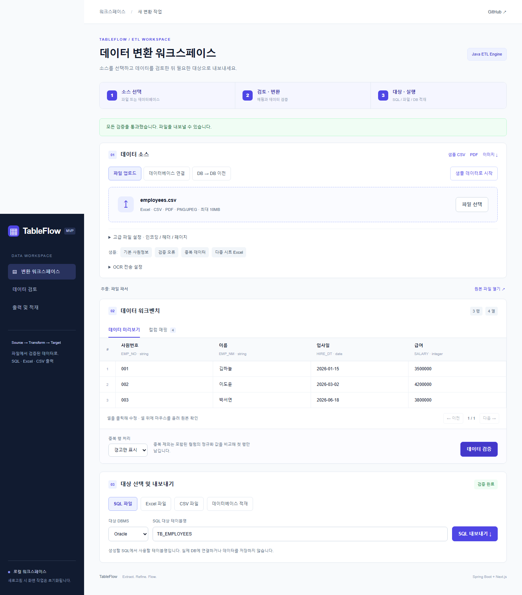
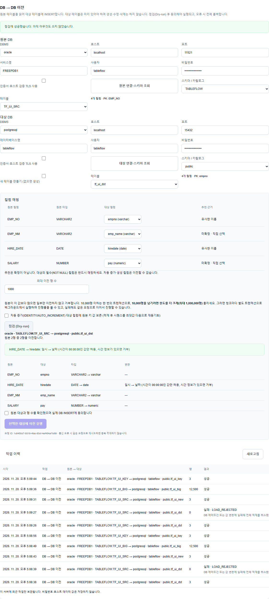
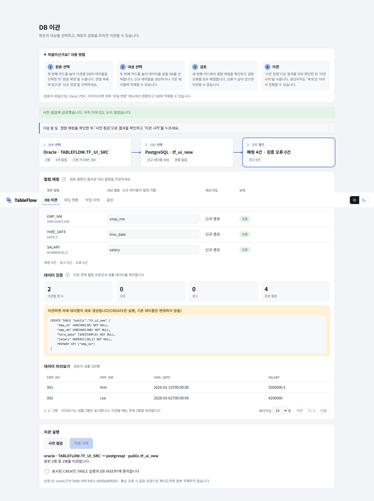
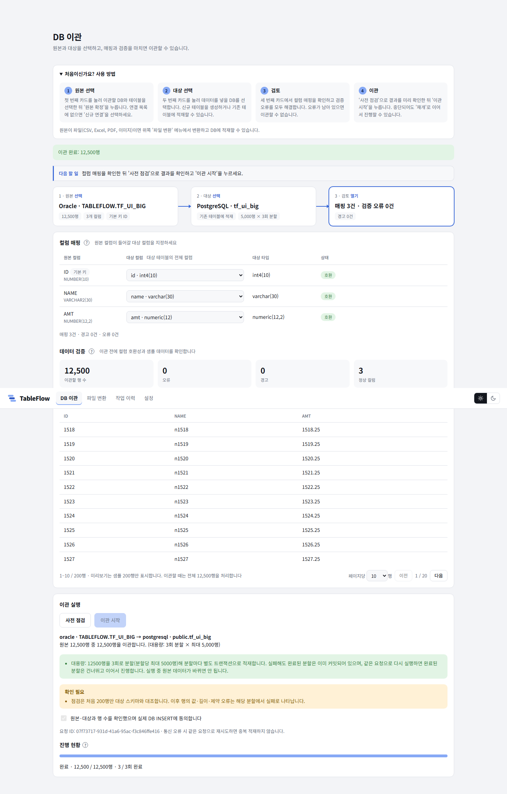

# TableFlow

파일(CSV·Excel·PDF·이미지)과 관계형 DB(Oracle · PostgreSQL · MySQL · MariaDB · SQL Server · CUBRID)를 **원본**과 **대상**으로 삼아 표 데이터를 검토·변환·이관하는 ETL 워크스페이스입니다.

- **파일 → SQL/파일/DB**: 파싱, 이미지·스캔 PDF는 로컬 OCR, 검증 후 INSERT SQL·CSV·XLSX로 내보내거나 DB에 적재
- **DB → DB 이관**: 기존 4종 DBMS, SQL Server, 제한 지원 CUBRID 이관(추가 DBMS는 관리자 반입 JDBC JAR 필요). 대용량은 분할 적재, 중단되면 같은 요청으로 **재개**
- **일괄 이관 · 값 변환 · 행 조건 · 사후 검증 · 스케줄**까지 갖춘 마이그레이션 도구

SQL Server의 반입 드라이버 설정과 Developer 실서버 검증 범위는 [내부망 전환 진행 기록](docs/INTRANET_PROGRESS.md)에 정리했습니다.

CUBRID·Tibero의 현재 검증 범위와 TLS/자동 증가 컬럼 제한은 [DBMS 확장 검증](docs/DBMS_EXPANSION.md)을 확인하세요.

스택: Spring Boot 3.5 (Java 21) · Next.js 16 / React 19 · FastAPI + RapidOCR

> **사용 전제.** 서버에 로그인·권한 관리가 없습니다. 개인 PC나 신뢰할 수 있는 내부망에서 쓰는 도구이며, 인터넷에 그대로 공개하면 안 됩니다. DB 기능은 기본값이 꺼짐이고, 공개 데모에서는 파일 변환만 노출하는 구성을 권장합니다. 공개 배포는 아직 하지 않았습니다.

## 화면

| 샘플 CSV → 검증 → SQL/Excel/CSV 출력 | DB → DB 이관 사전 점검 (Oracle → PostgreSQL) |
|---|---|
|  |  |

| 새 테이블 만들기 (CREATE TABLE 미리보기) | 대용량 분할 이관 완료 + 작업 이력 |
|---|---|
|  |  |

화면은 왼쪽 메뉴의 **DB 이관 · 일괄 이관 · 파일 변환 · 스케줄 · 작업 이력 · 설정**으로 나뉩니다. 스크린샷은 `SCREENSHOTS=true npx playwright test tests/screenshots.spec.ts`로 다시 만들 수 있습니다(DB 화면은 실제 DB 컨테이너 필요).

## 주요 기능

### 이관 (DB → DB)
- **컬럼 매핑**: 이름·업무 용어·유사도로 자동 추천(모호하면 미확정, 적용은 사용자 확인 후). 대상 타입·길이·정밀도 직접 지정
- **사전 점검**: 실제로 쓰기 전에 행 수, 타입 변환, 거부 사유, 생성될 DDL을 보여 주고 동의를 받은 뒤 적재
- **대상 테이블 자동 생성**: 인덱스·기본값·외래 키 복제 옵션, 부모 테이블 이관 순서 계산(순환 감지)
- **분할 적재와 재개**: 기본 키 기준 keyset 읽기로 분할(기본 5,000행)마다 별도 트랜잭션과 적재 영수증을 남깁니다. 실패·중단 시 같은 요청으로 이어서 실행하며 완료된 분할은 건너뜁니다. 서버를 재시작해도 작업 목록이 남습니다
- **원본 키 보존**: 자동 증가 컬럼에 원본 값을 넣고 시퀀스를 재동기화(PostgreSQL `setval`, Oracle, MySQL/MariaDB)
- **행 조건(WHERE)과 컬럼 선택**: 입력을 검증해 DML/DDL·주석·세미콜론·`UNION` 등을 차단합니다
- **값 변환 규칙**: 값 치환, 계산식, 날짜 형식 변경, 정규식 치환·추출, 조건별 값 등. 안전한 평가기를 사용하며 임의 코드는 실행하지 않습니다
- **이관 후 검증**: 원본·대상 건수와 집계 비교(전체 데이터 체크섬은 미구현)
- **일괄 이관**: 여러 테이블·스키마를 외래 키 순서로 통째 이관(최대 200개), 중단 후 재개. 테이블별 행 조건·컬럼 제외·대상 컬럼 이름·값 변환 규칙, 이관 후 테이블별 검증
- **스케줄**: 매일 정해진 시각 또는 일정 간격으로 자동 실행, 실행 때마다 대상을 비우고 다시 적재하는 모드. 비밀번호를 저장한 연결만 사용 가능

### 파일 변환
- CSV(UTF-8/BOM, MS949, EUC-KR, 구분자 자동), XLSX(시트·헤더 행 선택, 수식 원문 보존), PDF 텍스트 표(최대 20페이지)
- 이미지·스캔 PDF는 **로컬 OCR**(RapidOCR + ONNX Runtime, 한글/영문). 셀별 신뢰도와 원본 대조 후 검토 확인
- 타입 추정, 셀 편집, 정규화(정수·소수·날짜·불리언), 필수값·길이·중복 검증
- Oracle/PostgreSQL/MySQL/MariaDB INSERT SQL, XLSX, CSV 다운로드, DB 직접 적재

### 안전장치
- 비밀번호는 Git·브라우저 저장소·로그·이력에 남기지 않습니다. 사용자가 **비밀번호 저장**을 선택한 연결만 AES-256-GCM으로 암호화해 상태 DB에 저장하며(키는 DB 밖의 서버 설정·파일), 키는 브라우저로 내려보내지 않습니다
- 모든 SQL은 PreparedStatement 바인딩과 식별자 인용을 사용합니다. 적재 영수증으로 같은 요청의 중복 적재를 막습니다
- 요청·업로드 크기, XLSX 압축 해제량, 요청 빈도 제한. CSV/Excel 수식 주입 방지
- 외부 OCR은 서버 허용과 파일별 동의가 모두 있어야 하며, 로컬 OCR이 실패해도 자동으로 외부 전송하지 않습니다

## 소개용 배포 (Vercel)

Vercel에는 프런트엔드(Next.js)만 올릴 수 있고 백엔드(Spring Boot)·OCR 서버는 없으므로, **소개용 배포에서는 기능이 동작하지 않습니다.** 환경변수 `NEXT_PUBLIC_DEMO_MODE=true`로 빌드하면 화면 위쪽에 "실제로는 동작하지 않는다"는 안내가 뜨고, 방문자 브라우저에서 어떤 서버로도 요청을 보내지 않습니다. 설정: Vercel 프로젝트의 Root Directory를 `frontend`로, 환경변수에 `NEXT_PUBLIC_DEMO_MODE=true`를 지정합니다. 실제 사용은 아래 「시작하기」로 로컬에서 실행하세요.

## 구조

```text
frontend/    Next.js 16 · React 19 · TypeScript · Tailwind 4
backend/     Java 21 · Spring Boot 3.5 · Gradle · JDBC · POI · Commons CSV · PDFBox
ai-service/  FastAPI · Pydantic · RapidOCR · ONNX Runtime · PDFium
infra/       실제 DB 통합 테스트용 일회용 컨테이너(Oracle·PostgreSQL·MySQL·MariaDB)
docs/        아키텍처 · API · 테스트 결과 · 인수인계
scripts/     Windows 실행 보조 스크립트
```

설계 요약은 [아키텍처](docs/architecture.md), 설계 근거와 알려진 한계는 [인수인계 문서](docs/HANDOFF.md)에 있습니다.

## 검증 현황

| 구분 | 결과 |
|---|---|
| 백엔드 단위·통합 | 220개, 실패 0, 건너뜀 7 (2026-11-27, 6종 DB 실서버 설정) |
| 브라우저 E2E (Playwright) | 42개 중 38 통과 · 4 건너뜀(CUBRID 2, 스크린샷 2), 실서버 DB·로컬 OCR 포함 |
| 실서버 이관 조합 | Oracle→PostgreSQL, PostgreSQL→Oracle, MySQL→MariaDB, MariaDB→PostgreSQL |
| 대용량 | Oracle→PostgreSQL 100만 행 41.4초(약 24,200행/초), 분할마다 걸린 시간이 거의 일정. 5개 컬럼, 백엔드 `-Xmx768m` 기준 |
| 원격 CI (GitHub Actions) | 기본 작업과, Oracle·PostgreSQL·MySQL·MariaDB를 띄워 통합 테스트·DB E2E를 돌리는 `database` 작업. SQL Server·CUBRID·Tibero는 CI에서 실행하지 않습니다 |

검증 서버: PostgreSQL 17, MySQL 8.4, MariaDB 11.8, Oracle Free 23(모두 일회용 Docker 컨테이너). 건너뛴 테스트는 검증으로 세지 않았습니다. 상세와 재현 방법은 [테스트 결과](docs/TEST_RESULTS.md)에 있습니다.

### 알려진 한계
- 인증·권한 없음(위 사용 전제 참고). 스케줄러는 서버가 켜져 있는 동안에만 동작하고 서버 시간대를 따릅니다. 증분 이관·실행 결과 알림은 없습니다
- 일괄 이관은 대상 테이블 이름과 대상 타입을 화면에서 지정할 수 없고(타입은 API만 지원)
- 테이블 생성은 적재와 별도로 확정되어, 새 테이블 생성 뒤 적재가 실패하면 빈 테이블이 남습니다. DB 이관·일괄 이관은 "실패하면 새로 만든 빈 테이블 삭제" 옵션(기본 꺼짐)으로 정리할 수 있고, 파일 → DB 적재에는 이 옵션이 없습니다
- 순환 외래 키는 일괄 이관에서만 적재 후 추가합니다(단건 이관은 부모가 대상에 있어야 생성, 자기 참조는 적재 후 생성). 기본값 복제는 숫자·문자·날짜 리터럴, 불리언, 현재 시각·오늘 날짜만 지원합니다
- 기본 키와 NOT NULL 고유 인덱스가 모두 없는 테이블은 OFFSET 방식이라 행이 많을수록 느려집니다(Oracle 원본 100만 행에서 약 6분, 키가 있으면 약 40초)
- 이관 후 검증은 집계 비교라 합계·길이가 같은 값 차이는 찾지 못합니다. 변환한 컬럼은 원본을 다시 읽어 계산하므로 큰 테이블에서는 검증이 오래 걸립니다
- PDF/OCR은 페이지당 한 개의 정방향 표와 첫 행 헤더를 전제로 합니다. 외부 OCR 공급자는 모의 HTTP 계약만 검증했습니다
- SQL Server JDBC 조회·이관·직접 적재는 지원하며 SQL 파일 내보내기 방언은 기존 4종입니다. CUBRID는 로컬 연결 및 기본 키 값을 일반 컬럼에 적재하는 범위에서 실서버 검증했습니다. Tibero는 실험 단계로 기본 비활성화·실서버 미검증이며 SQLite는 미지원입니다

전체 목록과 우선순위는 [인수인계 문서 §4](docs/HANDOFF.md)에 있습니다.

## 시작하기

필수 환경: **JDK 21**, **Node.js 20.9 이상**, **PostgreSQL(상태 DB, 개발에서는 Docker)**, (OCR 사용 시) **Python 3.13**. Gradle은 저장소의 wrapper를 씁니다.

먼저 상태 DB를 준비합니다. 백엔드는 상태 DB가 없으면 시작하지 않습니다. `.env.example`을 `.env`로 복사해 비밀번호들을 바꾼 뒤 실행하세요.

```powershell
cd C:\dev\TableFlow
docker compose up -d --wait state-db   # 개발용 PostgreSQL, 127.0.0.1:15442
```

첫 번째 터미널 — 백엔드(포트 8080):

```powershell
cd C:\dev\TableFlow
.\scripts\backend.ps1        # 설치된 JDK 21을 자동 탐색. 다른 PC에서는 JAVA_HOME을 설정하세요
```

두 번째 터미널 — 프런트엔드(포트 3100):

```powershell
cd C:\dev\TableFlow\frontend
npm ci
npm run dev
```

- 화면 <http://localhost:3100> · API 상태 <http://localhost:8080/api/v1/health>
- Linux/macOS: `JAVA_HOME`을 JDK 21로, `TABLEFLOW_STATE_DB_URL`(`jdbc:postgresql://127.0.0.1:15442/tableflow`)·`TABLEFLOW_STATE_DB_USER`(`tableflow`)·`TABLEFLOW_STATE_DB_PASSWORD`를 설정하고 `cd backend && bash gradlew bootRun`
- 처음 쓴다면 화면의 **샘플 데이터로 시작**으로 파일 변환 흐름을 바로 체험할 수 있습니다

### DB 기능 켜기
DB 연결·이관은 기본이 꺼져 있습니다. 로컬에서만 켜세요.

```powershell
$env:TABLEFLOW_JDBC_ENABLED='true'; $env:TABLEFLOW_JDBC_LOAD_ENABLED='true'
.\scripts\backend.ps1
```

설정 항목과 권한·롤백·재시도 안내는 [DB 적재 문서](docs/database-loading.md)와 [JDBC 문서](docs/jdbc-loading.md)를 보세요.

### OCR 켜기 (이미지·스캔 PDF)
세 번째 터미널에서 OCR 서비스를 실행합니다. 최초 준비 때 한글 모델을 내려받으며, 이후 추론은 로컬에서만 실행됩니다.

```powershell
cd C:\dev\TableFlow\ai-service
python -m venv .venv
.\.venv\Scripts\python.exe -m pip install -r requirements.txt
.\.venv\Scripts\python.exe prepare_models.py
cd ..
.\scripts\ocr.ps1 -Provider local
```

Provider를 생략하면 고정 데이터를 돌려주는 mock이 실행됩니다. 자세한 운영은 [OCR 문서](docs/ocr.md)에 있습니다.

## 테스트 실행

이관 대상 DB 없이 돌리는 기본 검증(상태 DB 시험용 컨테이너는 필요합니다):

```powershell
cd C:\dev\TableFlow
docker compose -f infra/state/compose.yml up -d --wait   # 시험용 상태 DB, 127.0.0.1:15443
cd backend
.\gradlew.bat test bootJar
cd ..\frontend
npm ci
$env:NEXT_PUBLIC_API_URL="http://localhost:18080/api/v1"
npm run build
npx playwright install chromium
npm run test:e2e
```

`java`가 JDK 21을 가리키도록 `PATH`를 설정하세요. 이 기본 실행에서는 실제 DB·로컬 OCR 테스트를 **건너뜁니다**(검증이 아닌 skipped로 집계).

실제 DB 통합 테스트는 TableFlow 전용 일회용 컨테이너(`infra/jdbc/compose.yml`, 루프백 포트 15432/13316/13317/11521)에서만 실행하세요. 운영·개인 DB로 포트를 바꾸지 마세요. 컨테이너의 계정·비밀번호는 테스트 전용 값입니다.

```powershell
cd C:\dev\TableFlow
docker compose -f infra/jdbc/compose.yml --profile oracle up -d --wait --wait-timeout 600
cd backend
$env:TABLEFLOW_TEST_JDBC='true'; $env:TABLEFLOW_TEST_JDBC_DBMS='oracle,postgresql,mysql,mariadb'
.\gradlew.bat test --rerun-tasks
```

브라우저 DB E2E와 로컬 OCR 포함 전체 실행 명령, Docker 복구 절차는 [인수인계 문서 §2](docs/HANDOFF.md)와 [테스트 결과](docs/TEST_RESULTS.md)를 따르세요.

## 설정과 제한

- 프런트엔드: `frontend/.env.example`을 `.env.local`로 복사해 `NEXT_PUBLIC_API_URL` 설정
- 상태 DB(필수, 기본값 없음): `TABLEFLOW_STATE_DB_URL`, `TABLEFLOW_STATE_DB_USER`, `TABLEFLOW_STATE_DB_PASSWORD`, `TABLEFLOW_STATE_DB_SCHEMA`(`tableflow`). PostgreSQL만 지원하며 원격 주소는 `sslmode=verify-full`이 필요합니다
- 백엔드: `PORT`(8080), `TABLEFLOW_FRONTEND_ORIGIN`(`http://localhost:3100`), `TABLEFLOW_OCR_URL`(`http://127.0.0.1:8000`), `TABLEFLOW_JDBC_ENABLED`, `TABLEFLOW_JDBC_LOAD_ENABLED`, `TABLEFLOW_SECRET_KEY`(저장 연결 암호화 키. 없으면 `data/connections.key`를 자동 생성). 괄호는 기본값입니다
- OCR: `TABLEFLOW_OCR_PROVIDER`(mock), `TABLEFLOW_OCR_LANGUAGE`(korean), `TABLEFLOW_OCR_TIMEOUT_SECONDS`
- 파일 최대 10MB, 10,000 데이터 행, 100열. PDF 최대 20페이지, OCR 이미지 최대 2,000만 픽셀. JSON 요청 최대 32MB, IP당 POST 120회/분(`TABLEFLOW_POSTS_PER_MINUTE`로 변경), 동시 처리 4건
- 파일 변환 중인 표는 서버에 영구 저장하지 않으며 새로고침하면 화면 작업이 사라집니다. 서버에는 작업 이력·저장 연결·JDBC 드라이버(상태 DB), 작업 목록(`data/jobs.json`), 스케줄(`data/schedules.json`)이 남고 모두 Git에서 제외됩니다
- 대상 DB에 적재된 행과 영수증은 롤백하지 않는 한 그대로 남습니다

## 문서

[인수인계 요약(먼저 읽기)](docs/HANDOFF_GPT.md) · [인수인계 상세](docs/HANDOFF.md) · [API](docs/api.md) · [아키텍처](docs/architecture.md) · [DBMS별 지원 범위](docs/DATABASE_SUPPORT.md) · [테스트 결과](docs/TEST_RESULTS.md) · [개발 현황](docs/DEVELOPMENT_STATUS.md) · [요구사항](docs/requirements.md)

## 라이선스

[MIT License](LICENSE)
