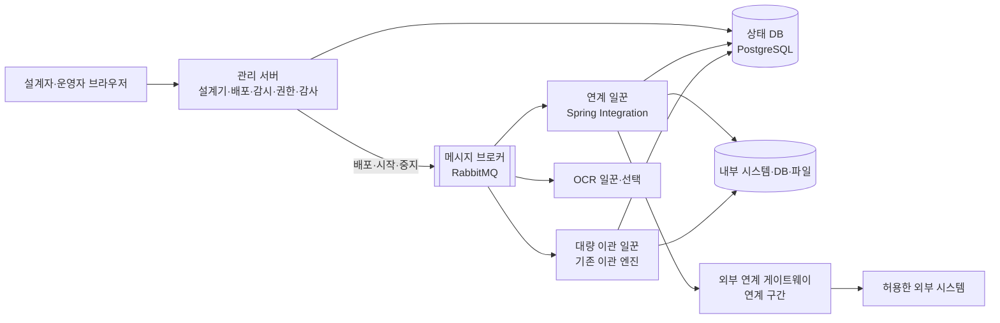

# TableFlow EAI 설계 기준

작성: 2026-11-27. 상태: **초안(검토 중)**. 단계 순서(§13)는 2026-11-27에 정했다. 이 문서의 EAI 기능은 아직 하나도 구현하지 않았다. "결정"은 사용자가 고른 것, "제안"은 검토가 필요한 것이다.

제품 방향이 "DB 이관(ETL) 도구"에서 **EAI 플랫폼**으로 바뀌었다. 상위 설계는 이 문서를 따른다. [내부망 설계 기준](INTRANET_ARCHITECTURE.md)의 설치·드라이버 반입·작업 신뢰성 규칙은 이 문서와 충돌하지 않는 범위에서 계속 유효하다.

## 1. 결정 사항 (2026-11-27)

| 항목 | 결정 |
|---|---|
| 목표 | EAI 플랫폼. 시연·포트폴리오 편의는 설계 제약으로 두지 않는다 |
| 기존 이관(ETL) | EAI의 **대량 배치 연계 모듈**로 흡수하고 검증한 코드를 재사용한다 |
| 연결 구조 | **혼합형**: 중앙에서 관리·감시, 전달은 메시지 브로커, 실행 일꾼은 늘려서 분산 |
| 흐름 작성 | **그림으로 설계**(끌어다 놓고 선으로 잇는 설계기) |
| 설치·망 | **내부망 설치 + 외부 연계**: 설치는 인터넷 없이, 실행 중에는 허용한 외부 대상과 연계 |
| 설치물 | **필요한 것을 모두 포함**: 의존 파일, 실행 도구, DB까지 함께 설치(§4.3) |
| 지원 OS | **Windows와 Linux 동시**. Linux는 **RHEL 계열**(RHEL·Rocky·AlmaLinux, RPM)부터 |
| 상태 DB | 설치물에 든 **내장 PostgreSQL만** |
| 첫 설치 패키지 | **2단계 직후 최소판** |
| 연계 엔진 | Spring Integration |
| 먼저 지원할 대상 | REST API, 파일·SFTP, DB(변경 감지 포함), 메시지 큐 |

## 2. 제품 정의 (제안)

회사 안의 시스템과 허용된 외부 시스템을 **흐름**으로 연결해, 메시지와 대량 데이터를 변환·전달·감시하는 설치형 플랫폼.

| 사용자 | 하는 일 |
|---|---|
| 연계 설계자 | 연결 등록, 흐름 설계·시험·배포 |
| 운영자 | 상태 감시, 실패 처리·재전송, 시작·중지 |
| 관리자 | 사용자·권한, 연결기·드라이버·인증서, 망 접근 정책 |
| 조회자(감사) | 이력·감사 기록 열람 |

범위에서 제외(현재): 사람이 결재하는 업무 프로세스(BPM), API 상품화·과금(API 관리 제품), 임의 스크립트 실행.

## 3. 용어

화면 문구는 아래 표기를 쓴다. 기존 규칙(이관, 원본/대상, 분할, 사전 점검, 컬럼 매핑, 기본 키, 재개)은 유지한다.

| 용어 | 의미 |
|---|---|
| 시스템 | 연계 대상(예: 인사 시스템, 외부 기관) |
| 연결 | 시스템에 접속하는 설정과 비밀정보 |
| 연결기 | 방식별 송수신 부품(REST, DB, 파일, 큐 등) |
| 흐름 | 수신부터 송신까지의 처리 그림. 버전을 가진다 |
| 단계 | 흐름 안의 한 칸 |
| 메시지 | 흐름을 지나가는 데이터 한 건 |
| 실행 | 메시지(또는 배치)가 흐름을 한 번 지나간 기록 |
| 실패 보관함 | 처리하지 못한 메시지를 모아 두고 다시 보내는 곳 |

## 4. 전체 구조

도식은 목표 구성이다. 현재는 Spring Boot 서버 하나, Next.js 화면, 선택 OCR 서비스만 있다.

### 4.1 구성요소

| 구성요소 | 책임 | 하지 않는 일 |
|---|---|---|
| 관리 서버 | 흐름 저장·검증·배포, 연결 관리, 감시 화면, 인증·권한·감사 | 업무 메시지 처리 |
| 연계 일꾼 | 배포된 흐름 실행, 연결기 송수신, 재시도 | 설계 변경 |
| 대량 이관 일꾼 | 분할 적재, 재개, 이관 후 검증 | 실시간 메시지 |
| 외부 연계 게이트웨이 | 외부와 통신하는 **유일한** 구성요소. 인증·인증서·허용 목록·속도 제한 | 업무 변환, DB 직접 접속 |
| 상태 DB | 정의·실행·추적·실패·권한·감사 | 대용량 본문 장기 보관 |
| 브로커 | 전달과 부하 분산 | 파일 저장, 최종 기록 |

### 4.2 원칙

- **관리와 실행의 분리:** 관리 서버가 멈춰도 이미 배포된 흐름은 계속 동작한다. 일꾼은 마지막으로 받은 배포본을 로컬에 보관한다.
- **작게 설치, 늘려서 확장:** 한 장비에 모두 설치할 수 있어야 하고, 같은 설치물로 일꾼만 늘릴 수 있어야 한다.
- **구성요소는 설치형:** 클라우드 서비스를 필수로 두지 않는다. 필요한 파일은 모두 반입한다.

### 4.3 설치물: 전부 포함 (결정 2026-11-27)

인터넷이 없는 장비에 **설치물 하나만 가져가서** 설치하고 동작해야 한다. 고객이 DB·런타임·라이브러리를 따로 준비하지 않는다. 설치 중에도 실행 중에도 아무것도 내려받지 않는다.

| 구성 | 설치물에 넣는 것 | 필요해지는 단계 | 확인할 것 |
|---|---|---|---|
| 앱 서버·일꾼 | Java 21 런타임, 앱 jar(Java 라이브러리 포함) | 지금 | 런타임 배포판 선정 |
| 화면 | 정적 파일을 앱 서버가 제공(제안: Node 런타임 불필요) | 지금 | Next.js 정적 내보내기 가능 여부, API 주소를 같은 출처 `/api`로 |
| 상태 DB | **내장** PostgreSQL 서버와 초기화·백업 도구(기존 사내 DB 연결은 지원하지 않음) | 1 | OS별 설치 방식, 큰 버전 업그레이드 절차 |
| 메시지 브로커 | RabbitMQ와 그 실행 환경(Erlang) | 2 | 버전 조합, OS별 설치 방식 |
| OCR | Python 런타임, 고정 버전 패키지, OCR 모델 | 선택 구성 | OS·CPU별 네이티브 패키지 |
| JDBC 드라이버 | 지금 앱에 포함된 4종, 그 밖은 반입 폴더 | 지금 | 재배포 조건 |
| 운영 도구 | 서비스 등록·시작·중지, 설정, 백업·복구, 점검 | 1부터 | - |
| 목록 | 구성요소 버전, SHA-256, 라이선스 | 1부터 | - |

- **배포 조건 확인이 먼저다.** 묶어서 배포해도 되는지 구성요소마다 확인한다. 특히 DB 드라이버(MySQL·Oracle 등)와 제조사 드라이버(SQL Server·CUBRID·Tibero)는 확인 전에는 포함하지 않고 관리자 반입으로 둔다.
- **Windows와 Linux를 동시에 지원한다(결정 2026-11-27).** 설치물은 OS·CPU별로 따로 만든다(CPU는 x64부터 제안). 사용자에게 Docker를 요구하지 않는다.
  - 두 OS에서 다른 것: 설치 형식, 서비스 등록(Windows 서비스 / systemd), 경로·파일 권한, DB·브로커·런타임·네이티브 패키지.
  - 앱 코드는 OS에 의존하지 않게 유지하고, 각 단계의 시험을 두 OS에서 실행한다. 한쪽에서만 확인한 기능은 다른 쪽 지원으로 표시하지 않는다.
  - 상용 UNIX(AIX, Solaris 등)는 범위에서 제외한다.
- 설치기는 점검(포트·디스크·권한) → DB 설치·초기화 → 브로커 → 앱 → 서비스 등록 → 동작 확인 순서로 진행하고, 내부 계정 비밀번호는 설치할 때 만든다.
- 데이터 폴더는 프로그램과 분리한다. 업그레이드는 데이터를 유지하고, 삭제는 선택하지 않으면 데이터를 남긴다.
- 묶는 작업은 인터넷이 되는 빌드 환경에서 하고 모든 버전을 고정한다.
- **각 단계는 새로 추가한 의존성을 설치 목록에 올려야 끝난 것으로 본다.** 최종 확인은 외부망을 차단한 깨끗한 장비에서 설치 → 실행 → 재시작이다.

## 5. 흐름 설계

### 5.1 흐름 모델

흐름은 **방향이 있는 그림**이며 버전이 있는 JSON 정의로 저장한다.

| 단계 종류 | 예 |
|---|---|
| 수신(시작) | REST 수신, 파일 도착, DB 변경 감지, 큐 수신, 예약 시각 |
| 변환 | 필드 매핑, 값 변환(`ValueTransform` 재사용), 형식 변환(JSON·XML·CSV) |
| 분기 | 조건에 따라 다음 단계 선택, 여러 대상으로 복제 |
| 보강 | DB·API 조회 결과를 메시지에 더하기 |
| 송신 | REST 호출, DB 적재, 파일 쓰기, 큐 발행 |
| 대량 이관 | 기존 이관 작업을 시작하고 결과를 기다리기 |
| 오류 처리 | 재시도, 실패 보관, 알림, 보상 호출 |

- 첫 버전은 **순환 없는 그림**만 허용하고, 허용 목록의 단계 종류만 쓴다.
- 사용자가 입력한 SpEL·스크립트·SQL 조각은 실행하지 않는다. 조건과 계산은 안전한 평가기로 한다. 중첩 필드는 제한된 경로 표기(JSON Pointer)부터 지원한다.
- 기존 행 조건(`where`)처럼 검사한 조건식을 DB에 전달하는 기능은 권한(설계자 이상)과 감사 대상이다.

### 5.2 생명주기

작성 → 정의 검사 → 시험 실행(실제 송신 없음 또는 시험 대상) → 배포(버전 고정) → 시작/중지 → 이전 버전으로 되돌리기.

- 실행 중인 메시지는 시작할 때의 버전으로 끝낸다.
- 일꾼은 정의를 Spring Integration 흐름으로 바꿔 실행 중에 등록·해제한다(`IntegrationFlowContext`, 6.5 참조 문서에서 확인).

### 5.3 설계기 화면

- Next.js 화면에 그림 설계기를 만든다. 라이브러리 후보는 React Flow(`@xyflow/react`). 라이선스·오프라인 반입·현재 React/Next 버전 호환을 확인한 뒤 정한다.
- 그림은 정의 JSON의 표현일 뿐이다. 같은 정의를 API로도 만들고 검사할 수 있어야 하며, **엔진은 설계기 없이 먼저 만들고 시험한다.**
- 키보드 조작과 목록 보기를 함께 제공한다.

## 6. 메시지

- 공통 정보: `messageId`, `correlationId`, `flowId`, `flowVersion`, `source`, `receivedAt`, `contentType`, `schemaVersion`, `attempt`, `payload` 또는 `payloadRef`.
- 본문 크기에 상한을 둔다. 큰 본문·파일은 저장소에 두고 참조만 전달한다. 다중 장비에서는 공유 저장 방식이 필요하다.
- 본문은 기본적으로 로그에 남기지 않는다. 추적용 보관은 흐름별 설정, 보관 기간, 마스킹, 열람 권한을 갖춘다.
- 비밀정보는 메시지에 넣지 않는다. 대량 이관 작업 큐에는 지금 설계처럼 식별자만 넣고, 업무 메시지 큐와 분리한다.

## 7. 전달 보장과 오류

- 기본은 **한 번 이상 전달**이다. "정확히 한 번"이라고 표현하지 않는다.
- 송신 단계마다 중복 방지 키를 둔다. DB 대상은 적재 영수증 방식을 확장한다. 중복을 막을 수 없는 대상(예: 일부 외부 API)은 화면에 표시한다.
- 저장과 발행 사이의 유실은 Outbox로 막는다. 처리 결과를 저장한 뒤 ACK한다.
- 재시도는 일시 오류만 횟수·간격을 제한한다. 인증·형식·제약 오류는 바로 실패 보관함으로 보낸다.
- 순서가 필요한 흐름은 순서 키를 지정하며, 그 키는 병렬 처리를 제한한다.
- 여러 시스템에 걸친 트랜잭션(2단계 커밋)은 제공하지 않는다. 필요하면 보상 단계를 설계한다.
- Spring Integration의 기본 메시지 보관은 메모리다. 유실되면 안 되는 구간은 브로커 또는 DB 저장소를 거친다.

## 8. 연결기

| 순서 | 연결기 | 비고 |
|---|---|---|
| 1 | REST(수신·호출), DB(적재·조회) | DB는 기존 JDBC 드라이버 반입·방언 재사용 |
| 2 | 파일·SFTP, RabbitMQ | 쓰는 중인 파일, 중복 도착 처리 |
| 3 | DB 변경 감지 | 기준 컬럼 주기 조회부터. 삭제 미감지를 표시. 로그 기반(Debezium)은 원본 설정·권한이 필요해 뒤에 |
| 4(확인 필요) | Kafka, SOAP, TCP 고정 길이 전문, 메일 | 외부 연계 대상이 정해지면 우선순위 결정 |

연결기 공통 계약: 설정 항목과 검사, 연결 시험, 수신/송신, 오류 분류(일시·영구), 비밀정보 처리, 제한값(크기·시간·동시 수), 시험용 대체 대상.

## 9. 보안과 망 구조

외부 연계가 들어가므로 지금의 "이 PC에서만 접속" 전제를 바꿔야 한다. **인증·권한(§13의 3단계)이 갖춰지기 전에는 바꾸지 않는다.**

| 구간 | 들어가는 것 | 규칙 |
|---|---|---|
| 내부 업무 구간 | 관리 서버, 일꾼, 상태 DB, 브로커 | 외부에서 직접 접근 불가 |
| 연계 구간 | 외부 연계 게이트웨이 | 내부와 외부 사이의 유일한 통로. 상태 DB·업무 DB에 직접 접속하지 않음 |
| 외부 | 허용한 상대 시스템 | 상대별 허용 목록 |

- 수신: TLS 필수, 상대 인증(키·인증서), IP 허용 목록, 크기·속도 제한, 재전송 공격 방지.
- 송신: 허용한 주소만. 인증서 검증을 끄는 설정은 제공하지 않는다.
- 사용자: 로그인, 역할(관리자·설계자·운영자·조회자), 설계와 배포 권한 분리 가능, 감사 기록.
- 비밀정보: 암호화 저장, 역할별 접근, 화면으로 다시 내려보내지 않음, 인증서 만료 알림.
- **설치와 갱신은 계속 오프라인**이다. 실행 중 외부 통신은 관리자가 등록한 연계 대상에 한한다. 라이브러리·모델·드라이버를 내려받지 않는다.
- 망 분리 규정과 연계 구간의 구성 방식은 설치 조직마다 다르므로 확인이 필요하다.

## 10. 상태 저장 (PostgreSQL)

사용자·역할·감사 / 시스템·연결(비밀정보 암호화) / 흐름·버전·배포 / 실행·단계 기록 / 메시지 추적 / 실패 보관 / 수신 위치(파일 처리 기록, DB 기준값) / 중복 방지 키 / Outbox / 예약과 실행권 / 이관 작업·분할 위치·이력.

대상 DB의 적재 영수증은 지금처럼 대상 DB에 둔다. 기존 JSON 파일은 백업 후 가져오는 절차를 제공한다.

## 11. 운영

흐름 상태판(처리량·지연·실패·대기), `correlationId` 추적, 실패 보관함의 원인 확인·수정·재전송, 알림, 일꾼 상태, 백업·복구, 보관 기간에 따른 정리.

## 12. 현재 코드와의 대응

| 지금 있는 것 | EAI에서의 위치 | 필요한 변경 |
|---|---|---|
| `load/`(이관·일괄·검증·DDL), `connection/JdbcReader` | 대량 이관 모듈·DB 연결기 | API 프로세스에서 일꾼으로 분리 |
| `DriverCatalog`, `JdbcExplorer`, `SqlDialect` | DB 연결기 | 연결기 공통 계약에 맞추기 |
| `ValueTransform`, `TableEngine`, 파일 파서 | 변환 단계·파일 연결기 | 표가 아닌 중첩 메시지 지원 |
| `ConnectionStore` | 연결 관리 | 상태 DB, 연결 종류 확장 |
| `JobStore`, `ScheduleStore`, `JobHistory` | 상태 DB | JSON 가져오기, 동시 갱신 |
| `MigrationJobs`(JVM 실행기), `ScheduleService` | 브로커·일꾼·예약 | 실행권·재전달·중복 방지 |
| `ConnectionController.localOnly`, `RequestLimits` | 인증·접근 정책 | 인증 도입 후 교체 |
| Next.js 화면 | 관리 화면 | 메뉴 재구성, 설계기·감시 화면 추가 |

## 13. 단계별 로드맵

**순서 결정(2026-11-27): 흐름 먼저.** 가장 불확실한 흐름·메시지 구조를 얇게 먼저 검증하고, 인증은 외부 공개와 다중 사용자 전에 갖춘다. 단계 안의 범위와 완료 기준은 제안이며 단계를 시작할 때 확정한다. 2026-11-25에 승인한 내부망 로드맵 6~11단계를 이 표가 대체한다.

| 단계 | 내용 | 완료 기준 | 옛 단계 |
|---|---|---|---|
| 1 [상태 DB](EAI_STEP1_STATE_DB.md) | PostgreSQL 저장, JSON 가져오기 | 재시작·동시 갱신·예약 중복 방지, 기존 기능 회귀 | 7 |
| 2 브로커 + 얇은 흐름 | RabbitMQ, Outbox, 연계 일꾼, 정의 JSON의 검사·배포, REST 수신 → 변환 → DB 적재, 실패 보관·재전송(API) | 일꾼 강제 종료·중복 전달·브로커 중단에서 유실·중복 적재 없음, 재시도·재전송 시험 | 8 일부 |
| 2-설치 최소 설치 패키지 | 앱·화면·Java·PostgreSQL·RabbitMQ를 묶은 Windows와 RHEL 계열 설치물(이 PC 접속 전용) | 외부망을 차단한 깨끗한 두 OS에서 설치 → 얇은 흐름 실행 → 재부팅 후 정상 → 삭제 시 데이터 보존 | 6, 11 일부 |
| 3 인증·권한·감사 | 로그인, 4역할, 감사 | 권한별 허용·거부 시험, 비밀정보 비노출 | 10 |
| 4 운영 화면 | 추적, 상태판, 실패 처리, 알림, 흐름 버전·되돌리기 | 장애 원인을 화면에서 찾고 재처리, 이전 버전 복귀 | - |
| 5 그림 설계기 | 단계 배치·연결·설정·검사·시험·배포 | 설계기에서 만든 정의와 API 정의가 같게 동작 | - |
| 6 연결기 확대 | 파일·SFTP, 큐, DB 변경 감지 | 연결기별 장애·중복·재시작 시험 | - |
| 7 외부 연계 | 게이트웨이, 인증서, 망 구간, 필요한 외부 방식 | 구간 규칙 위반 차단 시험, 인증 실패·만료 처리 | - |
| 8 흐름 고도화 | 분기·모으기·보상, 기존 이관을 일꾼으로 분리해 대량 이관 단계로 연결 | 중간 실패에서 안전한 재실행, 이관 회귀 통과 | 8 일부, 12 일부 |
| 9 설치·제품화 | §4.3의 전부 포함 설치 패키지, OCR 일꾼, 일꾼 확장, 백업·업그레이드 | 인터넷 없는 장비에서 설치 → 연계 → 복구 | 6, 9, 11 |

- **3단계(인증)가 끝나기 전에는** 관리 화면·수신 API 모두 지금처럼 이 PC(루프백)에서만 연다. 다른 PC나 외부에 열지 않는다.
- 8단계 전까지 기존 DB 이관은 지금처럼 API 서버 안에서 실행한다.
- 외부 연계에 기한이나 정해진 상대가 생기면 3·7단계를 앞당기는 것을 다시 검토한다.
- 규모가 커서 단계마다 따로 설계 상세와 시험 계획을 만든다. 소요 기간은 추정하지 않았다.
- 오프라인 원칙(자동 내려받기 금지, 의존성 반입)은 9단계를 기다리지 않고 1단계부터 지킨다.

## 14. 열린 결정

1. **외부 연계 상대와 방식.** SOAP, 고정 길이 전문, 파일 교환 등 무엇이 필요한가. 연결기와 게이트웨이 설계가 달라진다.
2. **규모.** 하루 메시지 수, 최대 본문 크기, 허용 지연. 브로커·보관·분산 설계의 기준이다.
3. **중단 허용 범위.** 이중화(무중단)가 필요한가. 필요하면 상태 DB·브로커·게이트웨이 구성이 크게 늘어난다.
4. **설치 환경.** Windows·RHEL 계열로 정했다. 지원할 RHEL 계열과 Windows의 버전, 망 분리 방식, 사내 인증(LDAP/AD) 연동 여부, 설치 시험에 쓸 가상 장비가 남았다.
5. **제품 이름과 화면 구성.** TableFlow 이름 유지 여부, 메뉴 재편 시점.
6. **데이터 보관.** 메시지 본문 보관 기간, 마스킹 대상, 열람 권한.
