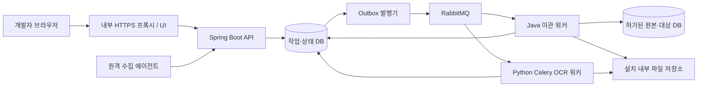

# 내부망 설치형 TableFlow 설계 기준

> **2026-11-27 방향 변경:** 제품이 EAI 플랫폼으로 확장된다. 상위 설계는 [EAI 설계 기준](EAI_ARCHITECTURE.md)(초안)을 따른다. 단계 순서(§8의 6~11단계)는 그 문서 §13이 대체한다. 제품 전제(§1)는 그 문서가 확정되면 대체된다. 설치·드라이버 반입·작업 신뢰성 규칙은 충돌하지 않는 범위에서 유효하다.

작성: 2026-11-25. 상태: 사용자 요구를 반영한 목표 설계와 코드 점검 결과. 아래 미구현 항목은 동작 보장이 아니다.

## 1. 제품 전제

- 사용자는 개발자·DB 운영자다. 인터넷 없이 설치하고 사용하는 환경을 기본으로 한다.
- 인터넷 단절은 외부망 단절을 뜻한다. 허가된 내부 DB·파일 서버·에이전트와 통신할 수 있다.
- 실제 제품은 고객 장비에 설치한다. Vercel은 기존 포트폴리오 소개용으로 유지한다.
- Java DB 이관 엔진을 유지한다. RabbitMQ는 작업 전달, Java 워커는 이관, Celery 워커는 Python OCR을 담당한다.
- JDBC 드라이버는 관리자가 파일을 직접 반입·등록한다. 실행 중 인터넷에서 내려받지 않는다.
- 향후 수집 에이전트는 원격 DB·파일 등의 정보를 수집한다. 여기서 에이전트는 반드시 LLM을 뜻하지 않는다.

## 2. 현재 코드 점검 결과

| 항목 | 근거 | 현재 제약 / 필요한 변경 |
|---|---|---|
| JDBC 드라이버 | `DriverCatalog`, `SingleJarClassLoader`, `Credentials.driverId` | 기존 4종 기본 제공 + 관리자 JAR 반입/버전 선택 구현. 원격 관리자·미사용 버전 삭제/교체 복구는 미구현 |
| 설치 구성 | 루트 `compose.yaml` | 샘플 MySQL만 제공. 프런트·API·워커를 설치하는 배포 묶음 없음 |
| 접근 경계 | `ConnectionController.localOnly`, `ScheduleController.localOnly` | 로컬 접속 전제. 내부망 다중 사용자 접속을 단순히 허용하면 안 됨 |
| 작업 실행 | `MigrationJobs`의 JVM Executor | API 프로세스에 종속. 브로커 ACK·재전달·실패 대기열 없음 |
| 저장 | `JobStore`, `ScheduleStore`, `ConnectionStore` | 로컬 JSON 파일. 여러 프로세스의 동시 갱신·실행권 관리를 지원하지 않음 |
| 스케줄 | `ScheduleService` | 프로세스 내 타이머. 여러 API 인스턴스에서는 중복 발행 방지 필요 |
| OCR | `ai-service/prepare_models.py`, 공급자 구현 | 모델 사전 준비 경로는 있지만 오프라인 설치물로 묶어 검증하지 않음 |
| 프런트 API | `frontend/src/lib/api.ts` | 기본 주소가 방문자 localhost. 서버 설치는 동일 출처 `/api` 역방향 프록시 필요 |
| 외부 OCR | `ai-service/app/providers.py` | 기존 opt-in 경로가 있음. 오프라인 모드에서는 명시적으로 차단해야 함 |
| 검증 | `MigrationVerifier` | 건수·집계 비교이며 암호학적 체크섬이 아님. 값이 다른 같은 길이 문자열 등을 놓칠 수 있음 |

현재 문서의 간헐 E2E 실패를 메모리 문제로 확정한 표현은 근거가 부족하다. 환경 영향은 가설이며 원인 미확정으로 취급한다.

## 3. 설치 형태

### 개인 PC 설치

브라우저는 loopback으로 접속하고 기존 로컬 경계를 유지한다. 제품의 기본 제공 형태는 OS별 설치 패키지다. Windows는 설치 프로그램과 서비스 등록, Linux는 배포판별 패키지와 서비스 등록을 제공하는 것을 목표로 한다. Docker/Compose는 개발·검증 및 선택 배포 방식이며 최종 사용자에게 필수로 요구하지 않는다. 현재 설치 프로그램은 구현되지 않았다.

### OS별 설치 패키지와 지원 범위

| 대상 | 목표 패키지 | 적용 범위 |
|---|---|---|
| Windows x64 | MSI/EXE 설치 프로그램 | Java 런타임·UI·API·Java 워커, 서비스 등록/삭제·업그레이드 |
| Linux x64 | RPM/DEB, 압축 배포본 | 배포판/버전 명시, systemd 실행·중지, 계정·파일 권한 |
| Linux ARM64 | 별도 빌드와 설치물 | JRE·Python 네이티브 의존성·OCR 모델 실행 검증 후 지원 표기 |
| UNIX | AIX/POWER, Solaris/SPARC 또는 x86 등 대상별 배포본 | 해당 OS용 Java 런타임과 서비스 등록 검증 후 지원 표기. Linux 패키지를 그대로 쓰지 않음 |

TableFlow 설치 OS와 원본/대상 DB 서버 OS는 별개다. Linux TableFlow에서 UNIX 서버의 DB에 JDBC로 연결할 수 있다(드라이버·DB 버전·네트워크 호환성은 별도 검증). 원격 수집 에이전트를 DB 서버에서 직접 실행해야 할 때 그 OS용 에이전트 배포본이 필요하다.

공통 Java 이관 코드는 공유하되 JRE, 서비스 래퍼, 경로, 권한, 네이티브 파일은 OS/CPU별로 패키징한다. JDBC Type 4 드라이버는 순수 Java인 경우 OS별 재빌드가 필요 없지만, 네이티브 인증 라이브러리 등 추가 구성은 해당 OS/CPU용으로 준비한다.

Celery는 OCR 전용이다. Windows나 UNIX에 Python OCR을 무조건 함께 설치하지 않는다. 초기 OCR 워커 지원 대상은 Linux이며 Windows/UNIX 설치본에서 내부망 Linux OCR 노드를 선택 연결할 수 있게 한다. 로컬 OCR 동봉은 해당 OS에서 별도로 검증한 경우에만 제공한다. RabbitMQ·내부 PostgreSQL도 로컬 설치 또는 내부망 서비스 연결을 선택하도록 설치 구성을 구분하고, 공급자가 지원하지 않는 OS에 종속 구성요소를 강제로 설치하지 않는다.

### 내부망 서버 설치

동일 출처 HTTPS 아래 UI와 API를 제공한다. 사용자 인증, 관리자/실행자 권한, 감사 기록을 갖춘 후 허용된 내부망 클라이언트를 받는다. 기존 loopback 제한을 무조건 제거하거나 프록시 헤더를 무조건 신뢰하지 않는다. 신뢰할 프록시와 클라이언트 접근 정책을 별도로 설정한다.

도식은 목표 구성이다. 현재 RabbitMQ·Celery·상태 DB·프록시·원격 에이전트는 구현되지 않았다. 내부 DB는 PostgreSQL 한 종류로 통일하고 외부 클라우드 서비스를 필수로 두지 않는다. OCR은 선택 구성으로 제공한다.

## 4. 오프라인 설치물

- 빌드는 인터넷 가능한 준비 환경 또는 사내 미러에서 수행한다. 고객 환경은 npm/pip/Gradle 다운로드 없이 설치·실행할 수 있어야 한다.
- OS/CPU별 앱·Java 런타임·서비스 등록 구성, 설정 예제, 실행/중지/백업/복구 스크립트, 의존성·라이선스 목록과 SHA-256 목록을 묶는다. PostgreSQL·RabbitMQ·OCR은 선택한 설치 형태에 맞는 오프라인 설치물 또는 기존 내부망 서비스 접속 설정을 제공한다. 컨테이너 배포를 고른 경우에만 이미지와 Compose 정의를 포함한다.
- OCR 모델·폰트·정적 자산을 포함한다. 모델이 없으면 자동 다운로드하지 않고 설치 오류와 반입 방법을 보여준다.
- 설치 전 포트·디스크·런타임·이미지·모델·드라이버 준비 여부를 점검한다.
- 업그레이드는 상태 DB 마이그레이션과 백업을 포함한다. 이전 버전 복구 가능 범위를 명시한다.
- 완료 기준: 외부 통신을 차단한 깨끗한 장비에서 설치 → 파일 변환 → DB 연결/이관 → 예약 실행 → 재시작/재개까지 검증한다.

## 5. JDBC 드라이버 반입·설치

1. 관리자가 DBMS 종류, 드라이버 이름·버전·클래스와 JAR 파일(필요한 의존 JAR 포함)을 등록한다.
2. 파일 크기·수량 제한, 실제 JAR 구조, 경로 조작, 중복·체크섬, Java 21 호환성을 검사한다. 검사는 악성 코드가 안전하다는 보증이 아니다. JDBC JAR은 실행 코드이므로 신뢰할 공급자 파일만 관리자가 설치한다.
3. 드라이버 버전별 디렉터리와 카탈로그에 기록한다. 서버 내부 경로는 사용자 파일명으로 만들지 않는다.
4. 초기 구현은 등록 후 워커 재시작으로 적용한다. 드라이버별 전용 ClassLoader와 명시적 `Driver.connect` 경로를 사용하고 버전을 연결 설정에 고정한다. 동일 클래스 이름의 내장 드라이버에 가려지지 않게 로딩 정책을 테스트한다.
5. 별도 검증 프로세스에서 클래스 로딩·버전·연결 검사를 수행한다. 이 프로세스도 보안 샌드박스라고 간주하지 않는다.
6. 실행 중인 작업과 스케줄이 사용하는 드라이버는 교체·삭제하지 못하게 한다. 신규 작업은 선택 버전을 사용하고 기존 작업은 고정 버전을 유지한다.

드라이버는 연결 구현이고 DBMS 방언은 별도다. Tibero 등의 JAR을 올린다고 테이블 생성 SQL·타입 변환·시퀀스·메타데이터 호환성이 자동 지원되지 않는다. 먼저 기존 4종의 버전 교체를 지원하고 새 DBMS는 방언과 실서버 테스트를 추가한다. 공급자별 재배포 허용 여부를 확인하고 고객 반입 드라이버를 기본 설치물에 무조건 포함하지 않는다.

## 6. 작업 상태·RabbitMQ·Celery

- 작업 상태, 요청 정의, 분할 체크포인트, 스케줄, 실행 이력과 잠금은 내부 PostgreSQL을 기준으로 한다. 기존 JSON은 백업 후 가져오는 마이그레이션을 제공한다. 대상 DB의 적재 영수증은 유지한다.
- 상태 저장과 브로커 발행 사이의 유실을 막기 위해 DB 트랜잭션에 Outbox를 함께 기록하고 발행기가 publisher confirm을 확인한다.
- 메시지에는 계약 버전, jobId, attemptId, 작업 종류, 생성 시각만 넣는다. 비밀번호·표 데이터·로컬 임의 경로는 넣지 않는다. Java와 Celery는 각각 별도 큐를 사용한다.
- Celery 작업은 Celery 프로토콜로 발행한다. Java AMQP JSON을 Celery가 그대로 소비한다고 가정하지 않는다. Python 작업 게이트웨이가 jobId로 Celery 작업을 발행하고, 발행 중복은 jobId/attemptId로 차단한다.
- 워커는 실행권을 DB에서 원자적으로 획득하고 heartbeat/lease를 갱신한다. lease 만료·재전달 때 중복 실행을 차단하고 기존 영수증으로 적재를 확인한다. 메시지 전달을 exactly-once라고 표현하지 않는다.
- 완료 상태와 체크포인트를 저장한 후 ACK한다. 재시도는 일시 오류만 횟수·지연을 제한해 수행하고, 인증·매핑·제약 오류는 사용자 수정 대상으로 기록한다. 한도를 넘으면 실패 대기열로 보낸다.
- 취소는 작업 DB의 취소 요청을 분할 경계에서 확인한다. 강제 종료 후 결과 미확정은 영수증으로 판별한다.
- RabbitMQ는 이미지나 업로드 파일 저장소가 아니다. 파일은 초기 단일 설치 장비의 공유 볼륨에 두고 작업 ID로 접근한다. 다중 장비 워커를 도입할 때 별도 파일 전송·보관 정책을 구현한다.
- 큐 분리 자체는 처리량 향상을 보장하지 않는다. 단일 큐 워커 장애·중복 발행·재시작·브로커 장애 테스트를 우선한다.
- 스케줄 발행자는 한 곳에서 실행권을 획득하고 예약 회차 ID에 유일 제약을 둔다. Celery Beat를 추가해 Java 스케줄과 이중 실행하지 않는다.
- 비밀키와 연결 자격증명은 역할별 접근을 제한한다. OCR 워커는 DB 이관 자격증명을 받을 필요가 없다.

## 7. 향후 원격 수집 에이전트

원본 DB가 중앙 서버에서 직접 접근되지 않는 환경을 대상으로 한다. 외부 서비스나 LLM은 필수가 아니다.

- 중앙 서버에서 임의 명령을 보내는 형태가 아닌, 허용된 수집 유형(DB 메타데이터·행, 지정 디렉터리 파일)별 작업 계약을 정의한다.
- 에이전트가 중앙 서버로 먼저 연결하며 장비 등록·인증·인증서 폐기·허용된 자원 범위를 관리한다. 중앙 서버와의 통신도 내부망에서만 가능해야 한다.
- DB 자격증명은 가능한 원본 측에 보관한다. 데이터 전송은 분할·체크섬·재시도·체크포인트로 처리한다.
- 수집한 자료에 원본 식별자, 스키마, 추출 시각, 작업 ID를 붙여 기존 변환·검증·적재 흐름에 연결한다.
- 연결이 끊기면 로컬 보관 한도와 만료 정책을 적용하고 복구 후 중복 없이 이어 보낸다. 파일·행 데이터는 로그에 남기지 않는다.
- 에이전트에 인터넷, 셸 실행, 임의 파일 접근을 기본 허용하지 않는다.

## 8. 사용자 승인 실행 순서 (2026-11-25)

이 순서는 원래 승인한 개발 로드맵이다. SQL Server까지 반영한 뒤 최신 사용자 재개 요청으로 4~5단계를 진행했다. 6~11단계는 아직 진행하지 않았고 12단계는 일부만 구현했다. 목표와 완료 상태를 혼동하지 않는다. 2026-11-27의 EAI 전환에 따른 새 단계 순서(흐름 먼저)는 [EAI 설계 기준](EAI_ARCHITECTURE.md) §13에 있으며 아래 6~11단계를 대체한다.

| 순서 | 작업 | 현재 상태 |
|---|---|---|
| 1 | DBMS 공통 처리 | 인용·페이지 조회·문자열 길이·카탈로그 규칙 통합. 기존 4종 회귀 검증. 조회/적재/DDL/키 보존 capability 및 실험 기능 활성화 상태를 API에 명시 |
| 2 | JDBC 드라이버 관리 | 로컬 관리자 JAR 등록·버전 선택·SHA-256 검사·저장 연결/작업 정의 유지 구현. 기존 4종 반입 JAR 실제 접속 검증. 삭제는 전체 금지해 참조 중 삭제 방지; 미사용 버전 삭제/교체 복구 UX는 미구현 |
| 3 | SQL Server | 관리자 반입 JDBC, 연결·조회·DDL·적재·IDENTITY 보존·재개 구현. SQL Server 2022 Developer 실서버 검증 4개 통과. 기존 검증 완료 범위 |
| 4 | Tibero | 실험 어댑터와 단위 테스트 3개 구현. 기본 비활성화. 정식 JDBC JAR·전용 인스턴스가 없어 실서버 미검증. 원격 TLS/기존 자동 증가 값 보존 미지원 |
| 5 | CUBRID | 11.3 UTF-8 실서버 검증 6개, 실제 브라우저 양방향 검증 2개 통과. 관리자 반입 JAR 사용. 원격 인증서 검증 TLS/기존 자동 증가 값 보존 미지원 |
| 6 | 오프라인 실행 기반 | 미구현. 동일 출처 API·OCR 모델/런타임 반입·외부망 차단 검증 필요 |
| 7 | PostgreSQL 상태 저장소 | 미구현. JSON 이관·원자적 갱신·스케줄 잠금 포함 |
| 8 | RabbitMQ + Java 이관 워커 | 미구현. Outbox·publisher confirm·lease·ACK·재전달/중복 방지 포함 |
| 9 | Celery OCR 워커 | 미구현. Python OCR 전용 큐·상태/결과·취소/재시도 포함 |
| 10 | 서버 인증·권한·감사 | 미구현. 현재 드라이버 관리의 로컬 관리자 키는 이 단계의 사용자/역할 인증을 대체하지 않음 |
| 11 | Windows/Linux 설치 패키지 | 미구현. 런타임 동봉·서비스 등록·제거/업그레이드·오프라인 검증 필요 |
| 12 | ETL 기능 보강 | 일부 구현(2026-11-26~27, HANDOFF §15~21): 테이블별 설정, 인덱스·FK 후처리 재개, 변환 결과 검증 등. 실제 체크섬은 미구현 |

UNIX·Kubernetes·원격 수집 에이전트 구현은 이 12단계의 필수 납품 범위에 추가하지 않는다. 에이전트 확장을 막지 않는 작업 계약을 유지한다.

## 9. 구현·검증 기록

현재 구현과 실행 방법은 [내부망 전환 진행 기록](INTRANET_PROGRESS.md)을 확인한다. 드라이버 등록은 코드 실행을 허가하는 관리 기능이며 신뢰할 수 있는 공급자의 JAR만 반입한다. 별도 JVM 샌드박스나 악성 코드 검사를 제공한다고 표현하지 않는다.

SQL Server Developer 약관 동의와 전용 테스트 설치는 2026-11-25 사용자가 승인했으며, 전용 루프백 컨테이너에서 검증했다. 기존 4종 검증 결과를 신규 DBMS 검증으로 집계하지 않는다.
