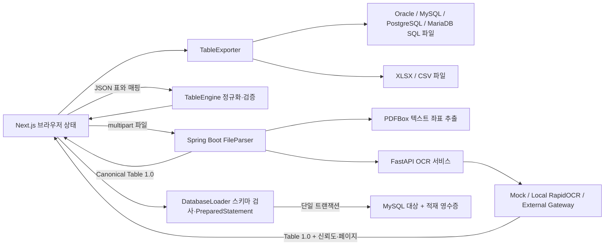
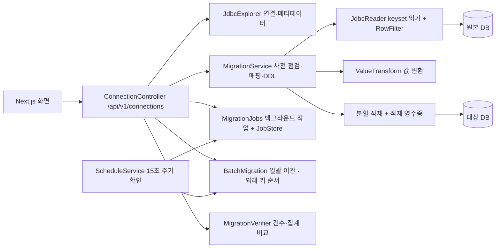

# 아키텍처

## 현재 구현

- Controller: HTTP 입출력만 담당. DTO의 Jakarta Validation과 서비스 검증을 함께 수행합니다.
- FileParser: 실제 Apache POI / Commons CSV 파싱. 파일을 디스크에 영구 저장하지 않습니다.
- Table: 컬럼 ID, raw/value, 수정 여부, 신뢰도(null), 버전이 있는 Java record 기반 공통 계약입니다.
- TableEngine: 규칙 기반 정규화, 필수·자료형·길이·정밀도·중복·셀 키 정합성 검사입니다.
- TableExporter: Oracle/MySQL/PostgreSQL/MariaDB enum dialect로 인용·리터럴을 분리합니다. 출력 전에 반드시 재검증합니다.
- 프런트엔드는 표를 메모리에 유지합니다. 50행 단위로 표시하며 편집 시 검증 결과를 무효화합니다.
- 인증·권한은 없습니다(로컬·내부망 도구 전제). 별도 메시지 큐나 내부 DB는 없고, 작업 목록·이력·스케줄·저장 연결은 서버 로컬 파일(`data/`, Git 제외)에 두며 중복 방지용 영수증만 대상 DB에 남깁니다. DB→DB 이관·일괄 이관·스케줄은 아래 「2026-11-22 현재 구성」을 보세요.

## 보안과 경계

XLSX ZIP 시그니처와 압축 해제량을 검사한 후 POI로 읽습니다. CSV는 허용 인코딩으로 엄격하게 디코딩하고 바이너리 제어 문자를 거부합니다. CSV 자체에는 고유 시그니처가 없어 확장자·디코딩·구조를 함께 확인합니다.

SQL 이름은 영문/숫자/밑줄 최대 64자의 단일 식별자로 제한합니다. 항상 인용하고 문자열 작은따옴표를 이스케이프합니다. MySQL 문자열은 SQL mode에 따른 백슬래시 해석 차이를 없애기 위해 UTF-8 HEX 리터럴로 출력합니다. 숫자는 BigDecimal 기반 문자열을 유지합니다.

Excel 수식을 읽을 때 실행하지 않고 수식 텍스트를 보존합니다. 출력에는 문자열 셀만 사용합니다. 파싱·오류 처리에서 업로드 내용을 로그로 기록하지 않습니다. HTTP multipart 임시 파일은 요청 종료 시 컨테이너가 정리합니다.

## Python OCR 통합

DocumentParser는 텍스트 PDF를 PDFBox로 처리하고 이미지·스캔 페이지는 OcrClient를 통해 FastAPI에 전달합니다. Python은 별도 작업 프로세스에서 실제 모델 추론/PDF 렌더링을 수행하며 deadline 초과 시 종료합니다. Java는 수신 계약을 다시 검증하고 사용자 원본 파일명으로 출처를 고정합니다.

OCR은 mock/local/external 공급자를 분리했습니다. 외부 전송에는 서버 opt-in과 파일별 동의가 모두 필요하며 로컬 실패 시 자동 전환하지 않습니다. 실제 로컬 모델로 4종 샘플과 전체 브라우저 흐름을 검증했습니다. 외부 어댑터는 모의 HTTP 계약만 검증했습니다. 상세: [OCR 운영·검증](ocr.md).

## 다음 단계

MySQL 직접 적재는 DatabaseLoader에서 기존 공통 검증 후 JDBC 바인딩·250행 배치·단일 트랜잭션으로 수행합니다. 대상 엔진/매핑/필수값/정밀도를 검사하고 메타데이터 잠금을 유지합니다. 대상 데이터와 영수증을 함께 커밋하여 재시도·동시 요청이 중복 적재되지 않도록 합니다. API는 로컬 전용입니다. [DB 적재 상세](database-loading.md)

공개 배포는 별도 Java 호스팅 선정 후 진행해야 합니다. 현재 로컬 UI를 공개 Live Demo로 표시하지 않습니다.

## 2026-11-19 워크스페이스 개편

파일 → Canonical Table → 정규화/검증 → 파일 출력 흐름을 유지했습니다. 범용 플러그인 프레임워크를 미리 도입하지 않고 기존 Dialect enum을 확장했습니다. 검증 severity와 중복 정책은 TableEngine에서 공유하고, 모든 파일 출력은 서버에서 재검증합니다. 화면의 이름 제안은 헤더 규칙 기반이며 실제 DB 스키마와 매칭한 결과가 아닙니다. (당시 기준이며 JDBC 연결·탐색·DB 소스 추출은 이후 구현했습니다. 아래 현재 구성 참고.) 기존 MySQL 적재의 PreparedStatement/트랜잭션/서버 설정 경계는 유지합니다.

## 2026-11-22 현재 구성 (DB 이관)

위 흐름에 DB를 원본/대상으로 쓰는 경로가 추가되었습니다. 전체 구현 상태와 한계는 [인수인계 문서](HANDOFF.md)가 기준입니다.

- **분할 적재·재개**: 기본 키 기준 keyset 읽기, 분할마다 별도 트랜잭션과 영수증(`tableflow_load_receipts`)을 커밋합니다. 요청 ID가 같으면 완료된 분할을 건너뛰고 이어서 실행합니다. 작업 목록은 `data/jobs.json`에 영속화되어 서버를 재시작해도 재개할 수 있습니다.
- **일괄 이관**: 테이블 목록을 외래 키 의존 순서(위상 정렬)로 처리하고, 테이블별 요청 ID를 결정적으로 만들어 중단 후 재개합니다.
- **행 조건**: `RowFilter`가 WHERE 문자열을 검증(주석·세미콜론·DML/DDL·`UNION` 등 차단)한 뒤 원본 쿼리에만 붙입니다.
- **스케줄**: `ScheduleService`가 15초마다 도래한 스케줄을 확인해 같은 작업 경로로 실행합니다. 서버 프로세스가 켜져 있는 동안에만 동작합니다.
- **저장 연결**: 사용자가 비밀번호 저장을 선택한 연결만 `ConnectionStore`가 AES-256-GCM으로 암호화해 `data/connections.json`에 둡니다. 스케줄·재개는 이 연결(`savedId`)만 사용하며 비밀번호는 정의에 저장하지 않습니다.
- **경계**: DB 기능은 기본 비활성(`tableflow.jdbc.enabled`, `load-enabled`)이고 접속 가능 호스트는 allowlist로 제한합니다.
